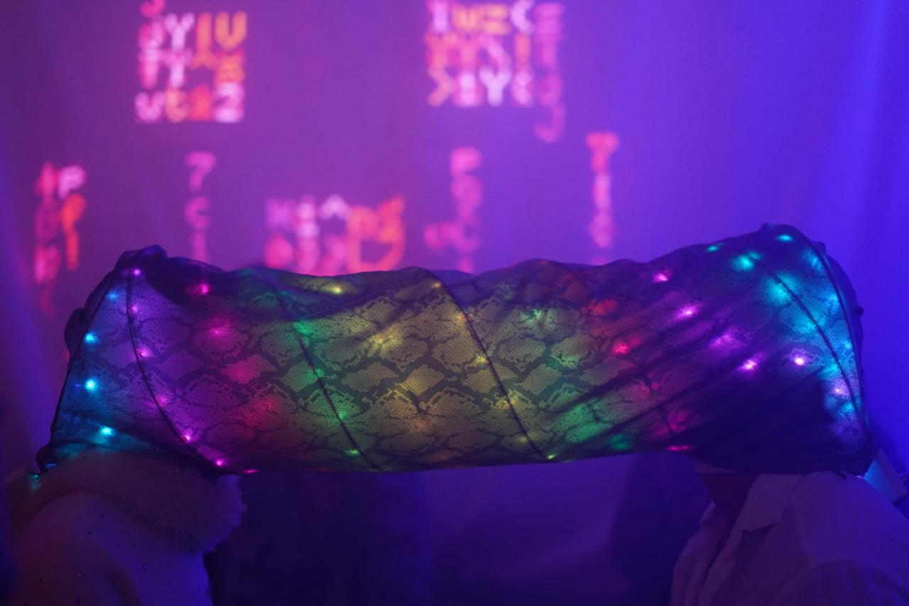
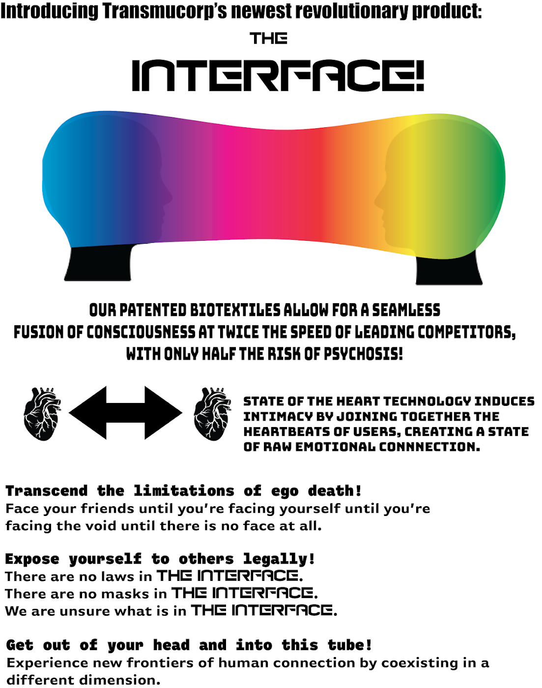
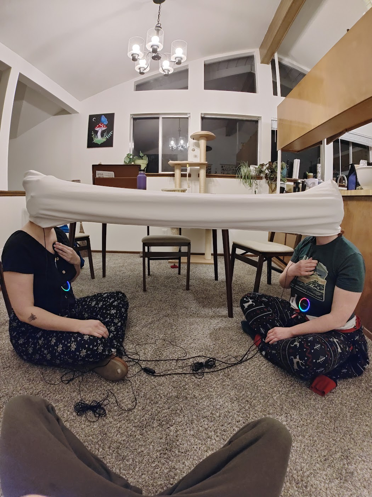
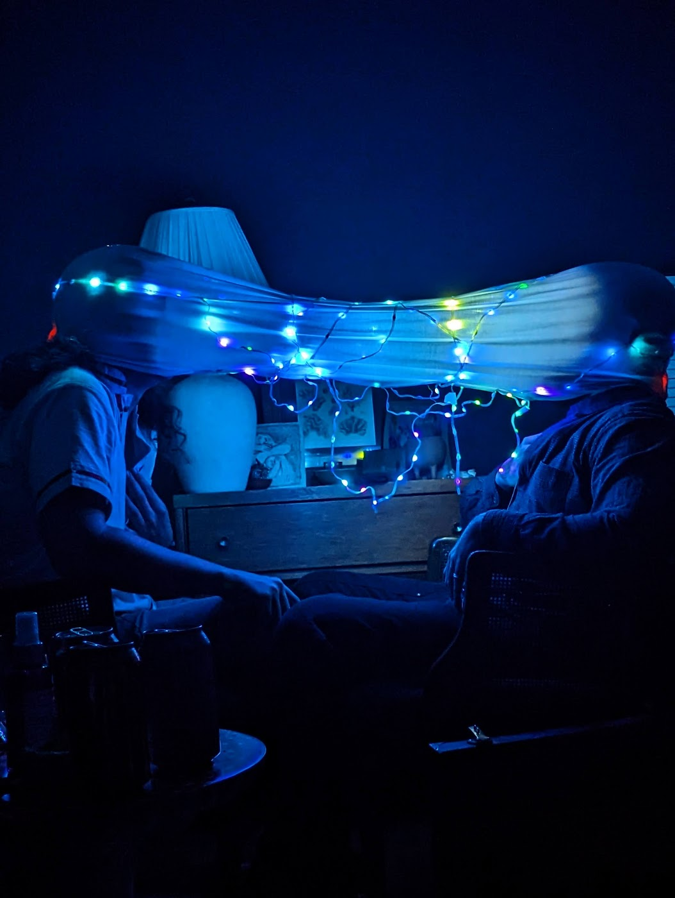
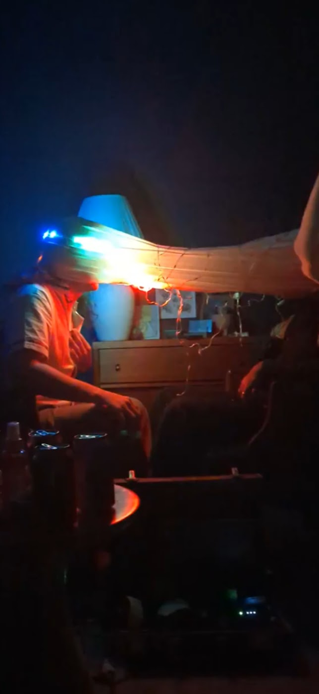
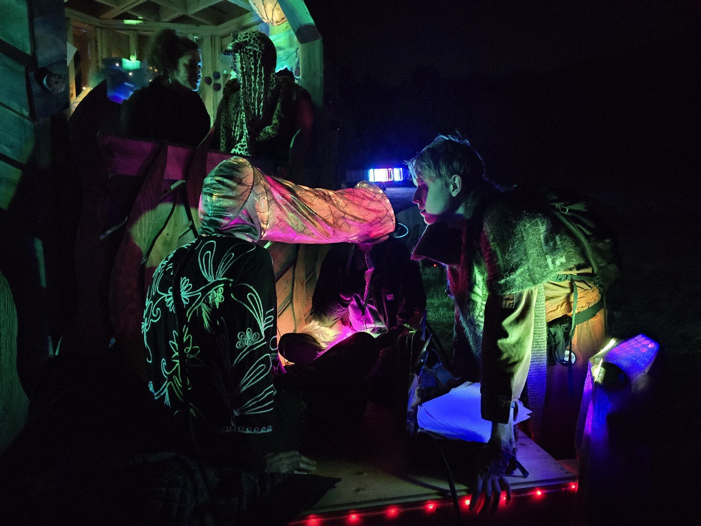
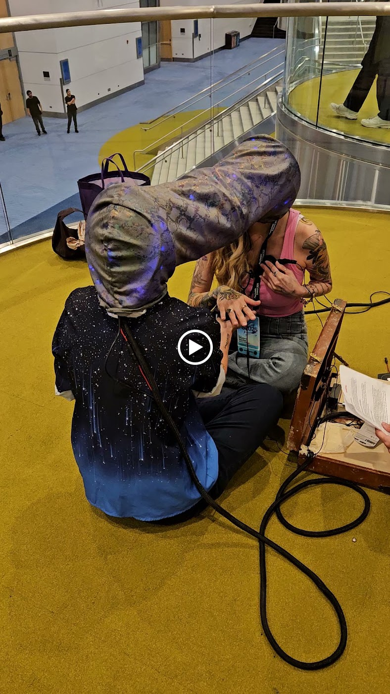

# The Interface

**A two-person biofeedback art installation that joins participants' heartbeats.**

Two people sit facing each other with their heads inside a shared fabric tube. Each wears a heart-rate
sensor and a vibration motor ("rumble pack"), and each has an LED strip that responds to their live
heartbeat. Each person feels the *other* person's heartbeat through their motor. When the two heart rates
come within about 5–10 BPM of each other, the system nudges them toward a shared rhythm.

The whole piece runs on a single Arduino Uno R4 Minima and is battery-powered, with no external computer.

<p align="center">
  
</p>

## Gallery

<p align="center">
  
</p>

| | |
|---|---|
|  |  |
| Early prototype test | String-light version, blue |
|  |  |
| String-light version, warm | Installed outdoors at night |

### Video

[](images/demo-video.mp4)

*Click the image to open the 11-second clip.*

## How it works

| Stage | What happens |
|---|---|
| No contact → calibrating | Each sensor automatically adjusts its IR/red LED current until the signal is in range. |
| Tracking | Beats are detected from a DC-removed IR waveform with an adaptive per-person threshold. BPM is a rolling eight-beat average, and HRV (RMSSD) and a rough SpO2 estimate are also tracked. |
| Heartbeat | Each detected beat triggers a smooth vibration pulse on the *partner's* motor and a brightness pulse on the LED strip. |
| Near-sync / sync | When the two BPMs get close, the strips reflect it and the system begins nudging both people toward a shared "flow state" rhythm. |

SpO2 is an uncalibrated biofeedback cue, not a medical reading.

## Hardware

| Component | Part |
|---|---|
| Microcontroller | Arduino Uno R4 Minima |
| Heart sensors ×2 | MAX30102 (each on its own SoftWire I2C bus, because both use address `0x57`) |
| Motor drivers ×2 | DRV8833 |
| LED strips ×2 | 44 addressable LEDs each |
| Controls | Button on A0 (mode/pattern), potentiometer on A2 (intensity) |

Full pin assignments, wiring colours and known hardware issues are in [CLAUDE.md](CLAUDE.md).
The design reasoning is in [DESIGN.md](DESIGN.md).

## Repository layout

| File | Purpose |
|---|---|
| [`theinterface.ino`](theinterface.ino) | Main sketch: sensing, calibration, beat detection, motors, LEDs, modes |
| [`InterfaceSensor.h`](InterfaceSensor.h) / [`.cpp`](InterfaceSensor.cpp) | MAX30102 driver built on SoftWire |
| [`HardwareTest/`](HardwareTest/HardwareTest.ino) | Serial-menu test for every LED strip, motor, sensor and control |
| [`LEDSimulator3D.html`](LEDSimulator3D.html) | In-browser 3D preview of the LED patterns |
| [`CHANGELOG.md`](CHANGELOG.md) | Change history |

## Building

Install the **SoftWire** and **Adafruit NeoPixel** libraries, then:

```bash
arduino-cli compile --fqbn arduino:renesas_uno:minima theinterface.ino
arduino-cli upload -p <PORT> --fqbn arduino:renesas_uno:minima theinterface.ino
```

To build the hardware test sketch:

```bash
arduino-cli compile --fqbn arduino:renesas_uno:minima --library . HardwareTest
```
